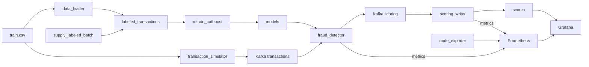

# Мониторинг скоринга фродовых транзакций

Сервис читает поток транзакций из Kafka, считает `score` и `fraud_flag` моделью CatBoost и пишет результат в PostgreSQL. Переобучение в Airflow публикует новый файл модели, скоринг подхватывает его без перезапуска контейнера. Prometheus снимает метрики раз в секунду, Grafana показывает дашборды и алерты.

Контракт скоринга не менялся: в топик `scoring` уходят `score`, `fraud_flag` и `model_version`. Для бизнес-графиков дополнительно пишутся `us_state`, `merch`, `cat_id`, `amount` и `is_night`.

## Запуск

Нужны Docker и Docker Compose v2. CSV в репозиторий не входит.

```bash
cp .env.example .env
```

В `TRAIN_DATA_CSV` укажите абсолютный путь к размеченному `train.csv`. Кавычки оставьте. Если порт на хосте занят, смените `POSTGRES_HOST_PORT`, `GRAFANA_HOST_PORT` или `PROMETHEUS_HOST_PORT`. Не открывайте чужой сервис на том же порту: на `3000` может оказаться не Grafana этого проекта, и пароль `admin` / `admin` туда не подойдёт.

```bash
docker compose up --build
```

Первый запуск собирает образ с CatBoost и загружает витрину. Пока `data_loader` не завершится, скоринг и Airflow не стартуют. Grafana и Prometheus поднимаются вместе с остальными сервисами в сети `ml-scorer`.

## Адреса

| Сервис | Адрес |
|--------|--------|
| Grafana | http://localhost:3000, логин `admin`, пароль `admin`. Если порт занят, в `.env` задайте `GRAFANA_HOST_PORT` и откройте этот порт |
| Prometheus | http://localhost:9090. Если порт занят, в `.env` задайте `PROMETHEUS_HOST_PORT` |
| Метрики скоринга | http://localhost:8000 |
| Метрики записи в БД | http://localhost:8001 |
| Kafka UI | http://localhost:8080 |
| Airflow | http://localhost:8081, логин `admin`, пароль `admin` |
| PostgreSQL | `localhost` и порт из `POSTGRES_HOST_PORT`, база `fraud_db` |

После старта Grafana уже содержит источник Prometheus, источник PostgreSQL и четыре дашборда. Ручная настройка не нужна. При первом входе можно нажать Skip и оставить `admin` / `admin`.

Дашборды лежат в папке Grafana **Fraud monitoring**:

| Дашборд | UID | Что смотреть |
|---------|-----|----------------|
| Обработка транзакций | `fraud-processing` | TPS, время обработки, доля фрода, тепловая карта скоров, доля ночных транзакций, ошибки, таблица по версиям модели из PostgreSQL |
| Запись результатов | `fraud-sink` | скорость и время записи, число фрода, распределение записанных скоров |
| Системные метрики | `host-metrics` | CPU, память, сеть, диск Node Exporter |
| Бизнес-аналитика фрода | `fraud-business` | фильтры по штату и мерчанту, плотность скоров, TPS выборки, доля фрода по `cat_id`, ночь/день, средний чек |

Алерты: **Alerting → Alert rules**, папка **Fraud alerts**.

## Как убедиться, что метрики идут с потока

1. Дождитесь, пока `transaction_simulator`, `fraud_detector` и `scoring_writer` в статусе `running`.
2. Откройте http://localhost:8000 : счётчик `fraud_scorer_processed_total` растёт, пока симулятор шлёт сообщения.
3. В Prometheus выполните `rate(fraud_scorer_processed_total[10s])` — значение около 10 при интервале симулятора 0.1 с.
4. На дашборде «Обработка транзакций» TPS, latency и тепловая карта скоров заполняются без ручного импорта JSON.
5. В PostgreSQL появляются строки:

```bash
docker compose exec postgres psql -U fraud_user -d fraud_db -c \
  "SELECT transaction_id, score, fraud_flag, model_version, us_state, merch, created_at FROM scores ORDER BY created_at DESC LIMIT 20;"
```

Если остановить симулятор, TPS падает к нулю. Это живой поток, а не один прогон по файлу.

## Смена версии модели на графике

Скоринг перед каждым сообщением читает `/artifacts/models/latest.txt`. Когда файл указывает на новую пару `my_catboost_<версия>.cbm` и `.preproc.json`, контейнер не перезапускается, а счётчик `fraud_scorer_model_reload_total{version="..."}` увеличивается на 1. На дашборде «Обработка транзакций» красная аннотация подписана версией и держится около 30 секунд: Grafana рисует её по запросу `fraud_scorer_model_reload_total unless fraud_scorer_model_reload_total offset 30s`. Смотрите сразу, период Last 5 minutes, слой аннотаций включён.

Быстрая проверка без ожидания DAG:

```bash
chmod +x scripts/publish_new_model.sh
./scripts/publish_new_model.sh demo1
```

Через несколько секунд на графике TPS/скоров появляется отметка `demo1`. Тот же эффект даёт ручной Trigger DAG `retrain_catboost` в Airflow, если кандидат проходит gate по ROC-AUC.

## Метрики

Имена не совпадают с семинарскими. Сбор каждые 1 с: `fraud_detector:8000`, `scoring_writer:8001`, `node-exporter:9100`.

### Скоринг (`fraud_detector`)

| Метрика | Тип | Зачем |
|---------|-----|--------|
| `fraud_scorer_processed_total` | Counter | число обработанных транзакций, TPS потока |
| `fraud_scorer_latency_seconds` | Histogram | время одной транзакции, среднее и p95 |
| `fraud_scorer_score` | Histogram | распределение скоров |
| `fraud_scorer_fraud_share` | Gauge | доля транзакций со score > 0.5 с старта процесса |
| `fraud_scorer_model_reload_total` | Counter, label `version` | момент горячей смены модели |
| `fraud_scorer_errors_total` | Counter | сообщения, на которых инференс упал |
| `fraud_scorer_night_txn_total` | Counter | **своё**: ночные транзакции (22:00–06:00). В антифроде ночь часто даёт другой риск. График «Доля ночных транзакций» на дашборде «Обработка транзакций» |
| `fraud_scorer_amount` | Histogram | сумма чека обработанных транзакций |

### Запись в PostgreSQL (`scoring_writer`)

| Метрика | Тип | Зачем |
|---------|-----|--------|
| `score_sink_written_total` | Counter | число записанных скоров |
| `score_sink_write_seconds` | Histogram | время INSERT |
| `score_sink_fraud_total` | Counter | записи с `fraud_flag = 1` |
| `score_sink_score` | Histogram | распределение скоров в базе |

### Хост (Node Exporter)

`node_cpu_seconds_total`, `node_memory_*`, `node_network_*_bytes_total`, `node_disk_*_bytes_total`, `node_filesystem_*`.

## Дашборды и фильтры

Источники подключаются из `grafana/provisioning/datasources/datasources.yaml`. JSON дашбордов — `grafana/dashboards/`, не копия семинара.

На «Обработке транзакций» рядом с Prometheus-графиками стоит таблица PostgreSQL: число скоров, доля фрода и средний скор **в разрезе `model_version`**. На одном экране видно, что процесс жив, и какая версия что насчитала.

На «Бизнес-аналитике фрода» переменные **Штат** (`us_state`) и **Мерчант** (`merch`) фильтруют:

- плотность распределения скоров (ось X — бакет скора, ось Y — доля транзакций в бакете);
- TPS транзакций выбранных штатов и мерчантов: число записей в бакете 10 секунд, делённое на 10.

Barplot «Средняя доля фрода по `cat_id`» строится по последним 1000 строкам `scores`.

Свои бизнес-графики:

- доля фрода ночью против дня — ночной риск часто ведёт себя иначе;
- средний чек фродовых и легитимных транзакций — сдвиг суммы помогает отделить массовый фрод от дорогих кейсов.

## Алерты

Правила в `grafana/provisioning/alerting/rules.yaml`, после запуска видны в Grafana → Alerting. Доставка в Telegram не нужна.

| Правило | Метрика | Порог | Как проверить |
|---------|---------|-------|----------------|
| Доля фрода выше порога | `fraud_scorer_fraud_share` | > 0.02 дольше 20 с | Если модель держит долю ниже 2%, в YAML поставьте `0.0001`, затем `docker compose restart grafana`. Через ~30 с правило в состоянии Alerting |
| Поток скоринга остановился | `rate(fraud_scorer_processed_total[30s])` | < 0.1 TPS дольше 45 с | `docker compose stop transaction_simulator`, подождите минуту. Вернуть поток: `docker compose start transaction_simulator` |
| Время обработки выросло | среднее `fraud_scorer_latency_seconds` | > 0.5 с дольше 30 с | срабатывает при деградации инференса |

## Архитектура



Переобучение оценивается как в предыдущем задании и заново не проверяется. Нужны работающий поток и возможность опубликовать новую модель — иначе на графике нечего отмечать.

## Очистка

```bash
docker compose down -v
```

Удаляются контейнеры, витрина, модели, состояние Airflow, тома Prometheus и Grafana.
